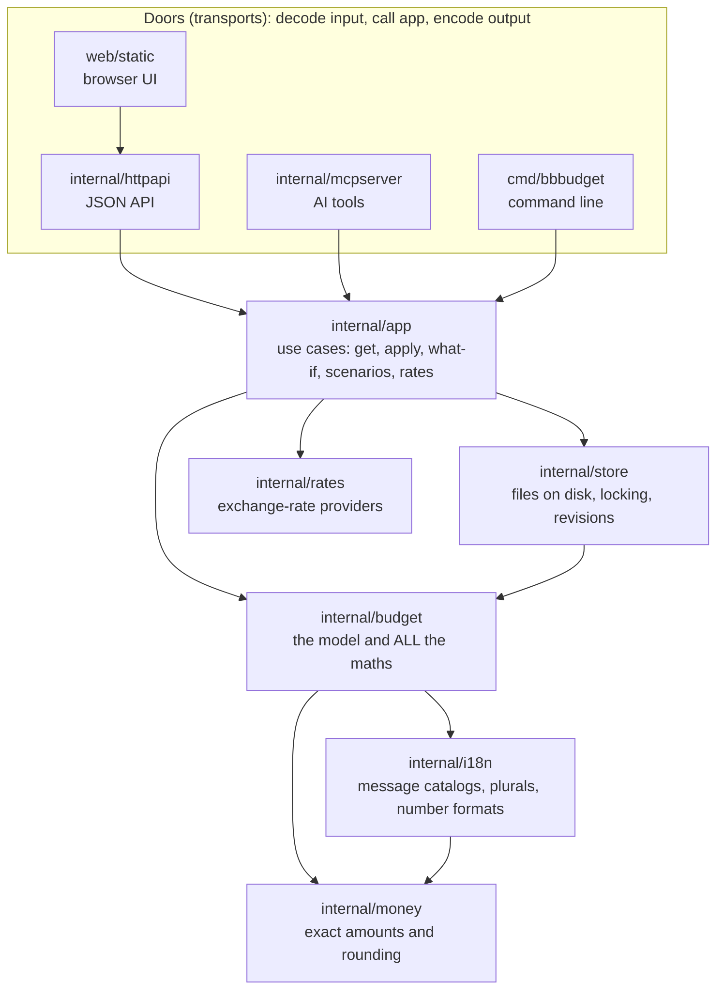
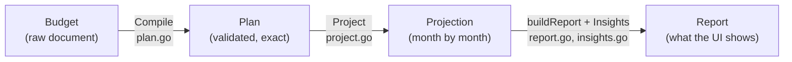
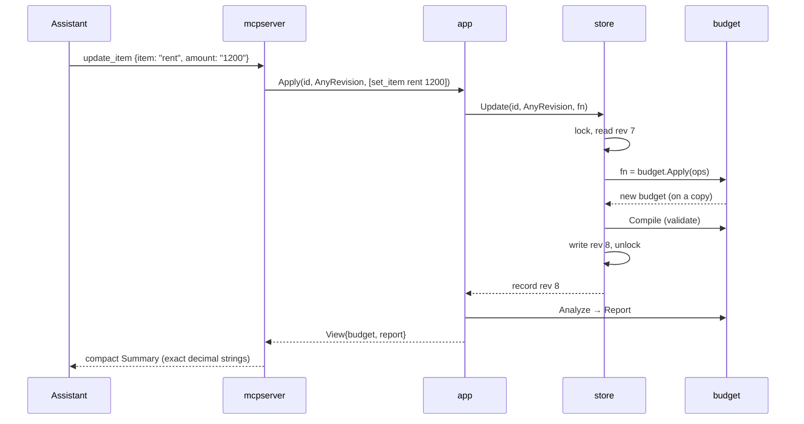

# How bbbudget is built

This is the map of the code: what each part is for, why it's shaped that way,
and where to look when you want to change something.

If you read only one paragraph, read this one:

> A budget is **one JSON file of plain data**: currencies, categories, items,
> debts, savings pots. Nothing calculated is ever stored. Every time anyone
> looks at a budget, the code **validates** it, **projects** it month by
> month with exact money, and builds a **report** from that. Every change
> goes through **one locked read-modify-write** on that file. The web UI, the
> command line and AI assistants (over MCP) are just different doors into
> the same code: none of them does any maths.

## The layers



Arrows mean "imports". They only ever point **down**: `money` knows nothing
about budgets, `budget` knows nothing about files, and nothing below the
doors knows HTTP or MCP exists.

**Why it's built like this:**

- **One place for maths means one answer.** If the UI worked out "left this
  month" in JavaScript and the AI got it from Go, they would eventually
  disagree. So every number comes from `internal/budget`, and the doors only
  format it.
- **Doors are cheap to add.** The MCP server only translates tool calls into
  `app` calls, so it stays small. An in-app chat or a phone app would be
  another door of the same kind. That's what makes an AI-first design
  practical: the AI isn't bolted on, it goes through the same door system
  as everything else.
- **Each layer is testable on its own.** `budget` is pure functions over
  data, so its tests need no files, servers or mocks.

## Five ideas that explain most of the code

### 1. The budget is a document; the report is computed

`budget.Budget` (in `internal/budget/model.go`) is what's saved: name, base
currency, start month, currencies with their rates, categories, items, debts,
savings pots, planned withdrawals and saved scenarios. It's the same thing
you'd write by hand in a YAML template.

Everything you *see* is a `budget.Report`, computed fresh from the document
on every read: monthly totals, the savings curve, payoff dates, shortfalls,
insights. It's never stored, so it can never go stale or contradict the
document.

### 2. Compile → Project → Report

Every read runs the same three steps, in `budget.Analyze` (`report.go`):



- **Compile** checks *everything* at once and turns text like `"45.50"`
  into exact money in the right currency. Problems come back as a list with
  paths (`items[3].amount: must not be negative`), which is how the UI
  highlights the right field. After Compile, the rest of the code can trust
  its input.
- **Project** walks the months. The numbered comments in `project.go` give
  the exact order. In short, each month it adds interest to debts, counts
  income and costs, pays debt minimums and any planned payoff, applies
  planned withdrawals from pots, and then deals with the leftover. A short
  month is owed (an overdraft), never quietly taken from savings. A surplus
  first repays what's owed, then pays pot contributions and the debt share,
  then fills the pots.
- **Report** adds up the totals and runs the **insight rules**. Each rule is
  a small function that looks at the projection and says one thing
  ("biggest recurring item", "the CHF risk"). They live in `insights.go`.

What those numbers *mean* (why savings are never income, why a short month
isn't covered automatically, which pot to offer first) is written down in
[`.claude/skills/personal-finance/SKILL.md`](.claude/skills/personal-finance/SKILL.md).
When the code and those rules disagree, the code is the bug.

### 3. Every change is an "op"

Changes aren't made by poking at fields. They're described as a list of
**ops**, small edit commands applied all or nothing (`ops.go`):

```json
[{"op": "set_item", "target": "rent", "value": {"amount": "1200"}},
 {"op": "add_item", "value": {"name": "Gym", "amount": "35", "category": "home",
                               "schedule": {"starts": "2027-01"}}}]
```

That one format is reused everywhere:

- the MCP tools build ops (`update_item` is a friendly wrapper for `set_item`);
- `apply_ops` and the HTTP `/ops` endpoint take them directly;
- **what-if** applies ops to a copy and never saves;
- **scenarios** are saved lists of ops, compared or adopted later.

`target` can be an id, an exact name, or an unambiguous part of a name, so
"rent" finds "Rent". An ambiguous match ("school" matching two items) is an
error, never a guess. Item schedules can be given in calendar months
(`"starts": "2027-01"`), which are turned into month numbers inside the same
locked write, so they always match the budget being edited.

The one exception is the web editor. It saves the **whole document**
(`PUT /api/budgets/{id}`) shortly after you stop typing, because a form is
naturally "here's the new state" rather than "here's an edit".

### 4. One locked read-modify-write, guarded by revisions

Every write, whatever door it came through, ends in `Store.Update(id,
expectedRevision, fn)` (`internal/store`):

1. take the lock (a lock file, so a running `bbbudget serve` and
   `bbbudget mcp` can share a directory safely);
2. read the current budget;
3. if the caller said "I'm editing revision 7" and the file is now at 8,
   stop with a **conflict** instead of overwriting someone else's change;
4. run `fn` (usually "apply these ops");
5. **validate** the result: invalid data is never written;
6. write it atomically (temp file, then rename) as revision 8.

The browser sends its revision, so if an AI changed the budget while you
were typing you get a conflict, not a silent overwrite. The UI also checks
every few seconds for a newer revision and reloads when it finds one, which
is how changes made elsewhere show up live. AI tools usually send
`AnyRevision`, meaning "apply on top of whatever is there". That's safe
because ops describe edits rather than whole states.

### 5. Exact money, rounded against you

`internal/money` stores amounts as whole numbers of the smallest unit
(cents, satoshi) in an `int64`, and rates as exact fractions (`big.Rat`).
There are **no floats anywhere money is involved**: `0.1 + 0.2` is exactly
`0.3` here.

When converting currencies, money **you pay rounds up** and money **you
receive rounds down**, by at most one minor unit each time. So the
projection is never optimistic because of rounding, and its totals always
add up exactly. The comment at the top of `project.go` lists the identities
that hold to the cent, and tests check them on hundreds of random budgets.

## Following one request all the way down

You tell an AI assistant: *"raise rent to 1200"*. Here's the path:



The same change through the **browser**: you edit the amount, `app.js` waits
a moment, then sends the whole document with `PUT`. `httpapi` calls
`app.Replace`, which goes through the same `store.Update` and comes back
with the same `View`. Through the **command line**, `bbbudget report home`
is `app.Get` → `Analyze`, printed as text.

Different doors, same middle.

## Package tour

Roughly in the order to read them. Skip the `_test.go` files at first; come
back to them when you want to see exactly what something guarantees.

| Package | Owns | Start with | Never does |
|---|---|---|---|
| `internal/money` | Amounts, decimals, currencies, rounding | `money.go` (the `Money` type), `currency.go` (the currency table) | know what a budget is |
| `internal/i18n` | Message catalogs (English, Russian), plural rules, number and month formats | `i18n.go`, then `locales/en.json` | know what a budget is |
| `internal/budget` | The document model, validation, projection, insights, ops, scenarios | `model.go` → `ops.go` → `plan.go` → `project.go` → `report.go` | touch files or the network |
| `internal/store` | Saving budgets: one JSON file each, lock, atomic writes, revisions | `store.go` (the small interface), then `file.go` | calculate anything |
| `internal/app` | Use cases every door shares: create, get, apply, what-if, scenarios, rate refresh, settings | `app.go` (short, read it whole), then `rates.go` | know about HTTP or MCP |
| `internal/accounts` | Several people on one server: an `App`, a data directory and a settings file per account | `accounts.go` | know about HTTP, or how an account signs in |
| `internal/devices` | Paired devices for remote mode: pairing codes and tokens, stored only as hashes | `devices.go` | know about HTTP |
| `internal/rates` | Fetching exchange rates (ECB, currency-api, CoinGecko) exactly, with caching | `rates.go` | see budget data (it only gets currency codes) |
| `internal/settings` | The app-wide preferences file (rate fetching, API key) | `settings.go` | store per-budget things |
| `internal/templates` | Starting budgets: built-in YAML plus your own folder | `templates.go`, `builtin/example.yaml` | |
| `internal/httpapi` | JSON API, serving the UI, mounting MCP at `/mcp`, localhost-only guards | the route list near the top of `httpapi.go` | do maths |
| `internal/mcpserver` | AI tools and their descriptions, the compact `Summary` output | the server instructions and `register` in `server.go`, then `summary.go` | do maths |
| `cmd/bbbudget` | The binary: `serve`, `mcp`, `init`, `report`, `rates`, … | the `switch` in `run` | do maths |
| `web/static` | The browser UI, plain JS with no build step | `app.js`: `open`, `save`, `poll`, then the `render*` functions | do maths (it only formats what the report says) |
| `e2e` | Browser tests: the real binary driven in headless Chromium | `ui.test.mjs` | |

**A suggested first read** (about an hour): `budget/model.go`, the top of
`budget/ops.go`, `budget.Analyze` in `report.go`, the numbered steps in
`project.go`, all of `app/app.go`, `Update` in `store/file.go`, and
`register` in `mcpserver/server.go`. After that, every other file is a
detail of something you've already seen.

## Where does my change go?

| You want to… | Put it in | Then |
|---|---|---|
| change how a number is calculated | `internal/budget` | add a test with a hand-checked number |
| add a new kind of edit | a case in `applyOne` (`budget/ops.go`) | it works in `apply_ops`, what-if, scenarios and HTTP for free |
| add an insight | a rule function in `budget/insights.go` | append it to `DefaultRules` |
| add something an AI should be able to do | an `app` method, then a tool in `mcpserver` | keep the tool thin; describe it well, the description is what the AI reads |
| show something new in the UI | the report (if it's a number), then `app.js` | never compute it in JS; add a browser test |
| store a new field | `budget.Budget` + validation in `Compile` | old files must still load or fail clearly |

The README's [Extending](README.md#extending) section covers currencies,
rate providers, templates and storage backends.

## The ground rules, and why

[CONTRIBUTING.md](CONTRIBUTING.md) lists them. The reasons:

- **No floats in money.** Floats can't represent `0.10` exactly, and over
  hundreds of months of interest the error becomes visible. Exactness is
  the point of the tool.
- **Maths only in `internal/budget`.** Explained above: one answer.
- **Dependencies point inward.** It keeps the core testable and the doors
  replaceable.
- **Nothing phones home.** Your budget never leaves your machine unless you
  turn something on. Rate fetching sends currency codes only.
