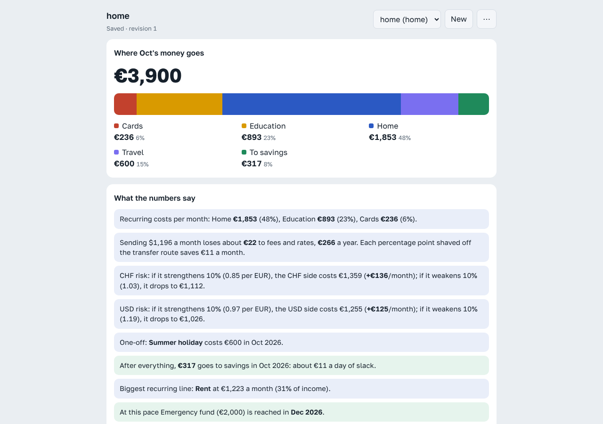

<div align="center">

# bbbudget

**A budget planner that does exact money math and keeps your numbers on your machine.**

Multi-currency household budgets, month-by-month projections, debt payoff and what-if scenarios.
A web UI, a CLI and an MCP server in a single Go binary that runs on your machine and keeps your numbers there.


<picture>
  <source media="(prefers-color-scheme: dark)" srcset="docs/screenshot-dark.png">
  
</picture>

</div>

## Why bbbudget

- 🔒 **Private by design.** No account, no cloud, no analytics, no tracking. Your budget is a plain file in your home directory. Out of the box it never touches the network. Fetching exchange rates is opt-in.
- 🧮 **Exact to the cent.** No floating point anywhere. Rounding is explicit and pessimistic, so the plan never looks better than reality.
- 💱 **Built for messy, multi-currency lives.** Get paid in one currency, pay rent in another and tuition in a third. bbbudget prices in the FX rate *and* the transfer fees you lose along the way.
- 📉 **Debts, goals and what-ifs.** Avalanche or snowball payoff, savings goal ETAs, and scenarios you compare side by side before changing anything.
- 🤖 **Talk to your budget.** A built-in MCP server lets Claude (or any MCP client) read and edit budgets: *"what if rent goes up to 1200?"*
- 📦 **One static binary.** The UI is embedded. No Node, no database, no Docker.

## Install

Packages for each release are on the [Releases](https://github.com/Ivanko1608/bbbudget/releases) page, for x86_64 and arm64. Each one installs a single static binary plus a systemd user service.

**Debian / Ubuntu**

```
sudo apt install ./bbbudget_<version>_amd64.deb
```

**Fedora / RHEL / openSUSE**

```
sudo dnf install ./bbbudget-<version>-1.x86_64.rpm      # openSUSE: sudo zypper install ./bbbudget-…rpm
```

**Arch Linux**: from the AUR (`yay -S bbbudget`), or install the release package directly:

```
sudo pacman -U ./bbbudget-<version>-1-x86_64.pkg.tar.zst
```

**Nix / NixOS**: try it without installing:

```
nix run github:Ivanko1608/bbbudget -- serve
```

Or add it to your system flake:

```nix
{
  inputs.bbbudget.url = "github:Ivanko1608/bbbudget";
  inputs.bbbudget.inputs.nixpkgs.follows = "nixpkgs";

  outputs = { nixpkgs, bbbudget, ... }: {
    nixosConfigurations.myhost = nixpkgs.lib.nixosSystem {
      modules = [
        bbbudget.nixosModules.default
        { programs.bbbudget.enable = true; }   # autoStart = true; starts it for every user at login
      ];
    };
  };
}
```

There's also `overlays.default` if you'd rather use `pkgs.bbbudget` with home-manager or anything else.

**From source** (Go 1.25+, the MCP SDK's minimum):

```
make build    # ./bin/bbbudget
```

### Run it in the background

Every package ships a systemd **user** service. It runs as you, on your own budgets, and only listens on `127.0.0.1`:

```
systemctl --user enable --now bbbudget     # then open http://127.0.0.1:8080
```

To change its flags, run `systemctl --user edit bbbudget` and clear the command before setting a new one (on NixOS the binary is `/run/current-system/sw/bin/bbbudget`):

```ini
[Service]
ExecStart=
ExecStart=/usr/bin/bbbudget serve -budget home
```

## Quick start

```
bbbudget init home -template example     # a fictional household to explore
bbbudget serve                           # http://127.0.0.1:8080  (MCP at /mcp)
bbbudget report home                     # projection + insights in the terminal
```

## Privacy

A budget is about as personal as data gets, so bbbudget is built to keep it on your machine:

- **Local only.** The server binds to `127.0.0.1` and refuses requests with a foreign `Host` header, which blocks DNS rebinding. Cross-site form posts are rejected as well (see [HTTP API](#http-api)).
- **No third-party requests from the UI.** The UI's scripts, styles and fonts are embedded in the binary. A strict `Content-Security-Policy` makes the browser refuse to contact any other origin, and `Referrer-Policy: no-referrer` is set too. There's no telemetry, no analytics and no update check.
- **Offline by default.** Fetching exchange rates is off until you turn it on in [Settings](#settings) (`fetch_rates`). Until then you type rates by hand and nothing goes online. Once it's on, the app contacts a rate provider only when you ask: **Update rates now**, adding a currency, `bbbudget rates`, or auto-refresh, which is off by default too. The request carries currency codes and nothing else: no amounts, no budget names. The provider still sees your IP address and which currencies you look up.
- **Your files, your format.** Budgets are plain JSON in `~/.local/share/bbbudget/`, so you can back them up, `grep` them, version them or delete them. Writes are atomic, so a crash never leaves you with half a file. Each budget's change history sits next to it (`home.jsonl`), holding copies of its last 200 versions (the file is trimmed in batches, so it can briefly hold up to 400), so something you remove from a budget stays in its history until it ages out. Deleting the budget deletes its history too.
- **Nothing personal in the repo.** Your own templates live in `~/.config/bbbudget/templates/`. `.gitignore` catches personal data accidentally pointed at the checkout, and an optional pre-commit hook scans for leaks (`make hooks`, see [Development](#development)).

One honest caveat: when you use the MCP server with a hosted AI assistant, the MCP server itself still runs locally, but whatever budget data the assistant reads is sent to that assistant's provider as part of the conversation. If that matters to you, use a local MCP client or stick to the web UI and CLI.

## What it models

| Concept | Notes |
|---|---|
| **Base currency** | Everything is projected in it (EUR in the example). Must be fiat. |
| **Currencies** | Fiat or crypto (BTC, ETH, SOL, LTC, BNB, XRP, ADA, TRX, DOGE, USDT, USDC, DAI). `per_base` rate (e.g. US$ per €), `transfer_fee_pct` (the share lost on every payment in that currency) and `cash_out_fee_pct` (the share lost when income in it is converted to base, such as fees for selling crypto). |
| **Rate source** | Per currency: `manual` (typed) or fetched from `ecb`, `currency-api`, `coingecko` or `auto`. See [Exchange rates](#exchange-rates). |
| **Categories** | `income` or `expense`, with a label and colour. |
| **Items** | Amount in any configured currency, with a schedule: monthly, every N months, or one-off. Each schedule has a start month and an optional end month. |
| **Debts** | Balance, APR and minimum payment, in any currency. Interest compounds monthly at APR/12. `extra_to_debt_pct` of each month's leftover is paid on top, ordered by strategy: `avalanche` (highest APR first), `snowball` (smallest balance first) or `listed`. A debt can be **paid off in full** in a chosen month, from a pot or from that month's money. The whole balance, that month's interest included, is paid after income sent to that pot has landed, so a sale can clear a debt in the month it arrives. A pot that holds less pays what it can; the rest stays owed, with its minimum. |
| **Savings pots** | Savings split by purpose: general savings, sinking funds (saving ahead for a known cost) and an emergency fund. Each has a balance and optionally a target and a fixed monthly contribution. Each month's leftover pays the contributions, then the share to debts, then fills pots with a target (top to bottom), then goes to the first general pot. |
| **Short months** | Savings are balances, never income. A month that falls short is **not** paid from savings automatically: it's reported with the pots that could cover it (general first, sinking funds next, the emergency fund last), and otherwise owed on the current account and repaid from the next surplus before anything is saved. |
| **Withdrawals** | Planned transfers out of a pot ("take €300 from General savings in October"), shown as *from savings*, never as income. One tap on a short month plans one. |
| **Scenarios** | Named sets of edits, compared side by side against the real budget. You can also adopt one into the budget. |

Insights cover category shares, transfer losses, cash-out losses, how much income is in volatile crypto and what a 30% fall would do, ±10% FX sensitivity, one-offs, slack this month, the biggest item, whether debt minimums cover interest, payoff dates, what paying a debt off in full costs and whether its pot can cover it, when each pot reaches its target, short months and how to cover them, withdrawals a pot can't fully pay, and a missing emergency fund (3–6 months of spending).

## Money handling

- **No floating point in any calculation.** Amounts are `int64` minor units (cents, pence; 0 digits for JPY, 3 for KWD). Rates and percentages are exact rationals (`math/big.Rat`). The one exception is chart pixel positions in the browser.
- **Exact on the wire.** Amounts, rates and percentages are JSON *strings* (`"1150"`, `"1.08"`). Bare JSON numbers are accepted on input and parsed from their literal text, never through `float64`. Exponents, `NaN`, thousands separators and more decimal places than the currency allows (`€1.001`) are rejected.
- **Rounding is explicit and pessimistic.** There is one rounding per conversion. Money you pay rounds **up**, money you receive rounds **down**, and interest charged to you rounds up. A plan therefore never looks better than reality, and is off by at most one minor unit per conversion.
- **Identities hold to the cent.** For every month, `left = income − expenses − debt minimums`, `left + from savings + change in overdraft = extra debt payment + into savings`, `saved = into savings − from savings`, `savings = previous + saved = the sum of the pots`, and every pot reconciles (`opening + in − out = closing`, never below zero). Each debt reconciles too: `opening + interest − payments = closing`. Extra payments never exceed their budget. A randomized test checks all of this over 400 budgets with awkward rates, mixed currencies, schedules, pots, withdrawals and overdrafts.
- **Overflow can't wrap.** Arithmetic is checked: overflow and currency mismatches become errors, never wrapped values or crashes. Inputs are bounded (amounts ≤ 10¹² units and ≤ 10¹⁵ minor units, ≤ 600 months).
- **Invalid data is never stored.** Every write is re-validated, and validation reports *all* problems with paths (`items[3].amount`). The UI highlights the matching fields.

## Exchange rates

Rates can be typed by hand or fetched. Each currency has a `source`:

| Source | What it is | Covers |
|---|---|---|
| `manual` | You type `per_base` (the default for existing budgets). | — |
| `ecb` | European Central Bank euro reference rates: official, published on working days around 16:00 CET. Non-EUR bases use cross rates through the euro. | ~30 major fiat currencies |
| `currency-api` | [fawazahmed0/currency-api](https://github.com/fawazahmed0/exchange-api): free daily rates aggregated from public sources, served by a CDN with a mirror. | ~300 fiat currencies and crypto |
| `coingecko` | CoinGecko live market prices. The keyless API is rate-limited; set `COINGECKO_API_KEY` to a free demo key to raise the limit. | Crypto only |
| `auto` | ECB where it has a rate, otherwise currency-api. | Everything |

Fetching is **off by default**, so bbbudget stays fully offline until you turn on `fetch_rates` in [Settings](#settings) (or run `bbbudget settings -set fetch_rates=true`). After that, rates are refreshed when you ask, or on a schedule if you turn that on too:

- **UI:** choose **Rate from** per currency, then **Update rates now**. Adding a currency or changing its source fetches its rate straight away. Typing a rate yourself switches that currency to manual.
- **CLI:** `bbbudget rates home` refreshes every non-manual currency. `-only USD,BTC` names currencies (a manual one named here switches to `auto`), and `-dry-run` shows the rates without saving. Put it in cron to keep a budget current.
- **Claude:** `refresh_rates`. `set_currency` on a new currency without `per_base` fetches the rate.

Fetched rates stay exact. Provider numbers are parsed from their text (including exponents like `1.35e-05`), never as floats. They are stored to 10 significant digits, and each currency records `rate_date` and `rate_from`. If a provider fails, its currencies keep their old rate and the others still update. A quote is cached for an hour.

### Settings

App-wide preferences live on the **Settings** page (top right of the UI), in `bbbudget settings`, or in `~/.config/bbbudget/settings.json` (`$BBBUDGET_SETTINGS`, `-settings FILE`). Each budget's own settings (base currency, months, debt strategy) stay on the budget page.

| Setting | Default | |
|---|---|---|
| `fetch_rates` | `false` | Off is fully offline: nothing contacts a rate provider and every rate is typed by hand. Turn it on to fetch rates. |
| `default_rate_source` | `auto` | The source a newly added currency gets. |
| `auto_refresh` | `off` | `hourly` or `daily`: while `bbbudget serve` runs, refresh every budget's non-manual rates. The page shows the last run. |
| `coingecko_api_key` | — | Optional CoinGecko demo key. The file is written with mode 0600, and the key is never sent back to the browser or printed. |
| `locale` | `auto` | The language for text. `auto` follows the browser in the UI, and `$LANG` for the CLI and MCP server. See [Languages](#languages). |

```
bbbudget settings                                   # show
bbbudget settings -set auto_refresh=daily -set default_rate_source=ecb
```

A broken settings file is an error naming the file, never silently replaced by defaults. Settings are re-read on every use, so a change from the CLI applies to a running server at once.

### Crypto income

Add the coin as a currency and write the income item in it: `0.015` BTC. Amounts allow the coin's configured decimals (8 for BTC, 6 for USDT). Set `cash_out_fee_pct` to what selling costs you. Income is then valued at the market rate minus that loss, and rounded down like any income. For volatile coins (stablecoins excluded), the insights show the coin's share of income and what a 30% fall would do to the month.

```yaml
currencies:
  - {code: BTC, source: auto, per_base: 0.0000135, cash_out_fee_pct: 1.5}
items:
  - {name: Freelance (paid in BTC), amount: 0.012, currency: BTC, category: income}
```

## The app

The UI has five views: **Overview** (where the money goes, ranked insights, the projection), **Items** (income and costs grouped by category, amounts editable in place), **Plan** (debts, savings pots, planned withdrawals), **Scenarios** (try changes, save and compare them) and **Setup** (budget settings, currencies, categories).

- **Wide screens** show the views as tabs next to a summary that stays in view: what's left this month, savings at the end, goal and debt-free dates and the top warning. Every edit's effect shows up there straight away.
- **Phones and small tablets** get an app layout: a bottom tab bar, a pinned bar with the two key numbers, and bottom sheets for editing an item. Touch targets are at least 44px, and safe-area insets clear notches and the home indicator.
- **Installable.** The page ships a web app manifest and icons, so a phone or desktop browser can install it ("Add to Home Screen"); it then opens full screen like an app. The same layout is meant to be wrapped as an Android or iOS app later (for example with Capacitor or a Trusted Web Activity). A native shell needs a reachable server; this one only listens on localhost.
- Deletes can be undone for a few seconds. The current view is in the URL (`#home/items`), so reloading keeps your place.

## Templates and your own data

Built in are `blank` and `example`, a fictional household that is also the test fixture. **Your own templates live outside the repository**, in `~/.config/bbbudget/templates/` (or `$BBBUDGET_TEMPLATES`, or `-templates DIR`), as YAML or JSON. The file name is the template name, and a file named like a built-in replaces it. Your budgets live in `~/.local/share/bbbudget/` (or `$BBBUDGET_DIR`, or `-dir`). Nothing personal ever needs to be in the repo.

```yaml
# ~/.config/bbbudget/templates/household.yaml
description: Our monthly budget
base_currency: EUR
extra_to_debt_pct: 50
currencies:
  - {code: USD, per_base: 1.08, transfer_fee_pct: 2}   # 2% lost on every USD payment
  - {code: GBP, source: ecb, per_base: 0.85}            # refreshed by `bbbudget rates`
categories:
  - {label: Income, kind: income}
  - {label: Home}                                        # kind defaults to expense
items:
  - {name: Salary, amount: 3900, category: income}       # currency defaults to base
  - {name: Rent, amount: 1150, category: home}           # schedule defaults to monthly
  - {name: Insurance, amount: 240, category: home, schedule: {every: 12, start: 2}}
  - {name: Flights, amount: 450.50, currency: USD, category: home, schedule: {every: 0, start: 1}}  # one-off
debts:
  - {name: Credit card, currency: USD, balance: 4000, apr_pct: 24, min_payment: 250}
  - {name: Car loan, balance: 6000, apr_pct: 7, min_payment: 180, payoff_month: 5, payoff_from: general-savings}  # pay it off from that pot in month 5
pots:                                                    # kind: general | sinking | emergency
  - {name: General savings, balance: 1200}               # kind defaults to general; gets the leftover
  - {name: Emergency fund, kind: emergency, balance: 0, target: 5000}
  - {name: Holiday, kind: sinking, balance: 300, target: 1500, monthly: 100}
withdrawals:                                             # optional: planned use of savings
  - {name: New tyres, pot: general-savings, amount: 400, schedule: {start: 3}}  # once, in month 3
```

Older files with `savings_start` and `goals` still load: the balance becomes a *General savings* pot and each goal a pot with that target (an *emergency* pot if its name says so). Old goals all counted the same money; as pots, each fills on its own.

```
bbbudget templates                         # list built-in and your templates
bbbudget init home -template household
bbbudget import home ./budget.yaml         # or create a budget straight from a file
```

Ids are derived from names when omitted. YAML numbers keep their exact text: `450.50` is never a float. Unknown fields, exponents and sub-cent amounts are rejected, and a broken template file is reported by file name. The format is the same document the API and **Download JSON** in the UI produce, so you can export a budget and save it as a template.

## Actual spending

The budget is a plan. **Transactions** are what really happened. Log them by telling your assistant ("I spent 40 on groceries", or paste a bank statement), from the command line, or over the API.

```
bbbudget log home 40 home -note "Lidl"            # today, base currency
bbbudget log home 12 education -currency USD -date 2026-10-03
```

- **Fixed values.** Each transaction's base-currency value is fixed when it's logged, using that day's rate and the plan's pessimistic rounding (costs up, income down). Spending already done doesn't change when rates move.
- **Safe re-imports.** A statement import gives each row an `external_id`, so pasting the same statement twice logs nothing twice.
- **All or nothing.** One bad row rejects the whole call, with an issue pointing at that row.
- **Corrections.** Each log call is a **batch**. `delete_transactions` with the batch id takes back a mistaken import in one go, and `update_transaction` fixes a single row.
- **Stored apart from the plan** (`home.ledger.json`). The plan stays small, an editor saving the whole plan can't drop transactions, and deleting the budget deletes them too.

The assistant does the parsing: the server never reads bank CSVs. The model reads the statement, picks a category for each row (and asks when one is unclear), and logs them in one call.

## Languages

The UI, the insights, schedule descriptions, month names, validation messages, change history and the CLI report come in **English** and **Russian**. Pick one on the Settings page, or with `bbbudget settings -set locale=ru`. `auto`, the default, follows your browser's languages in the UI and `$LANG` on the command line.

Numbers follow the language as well: `€1,235` in English and `1 235 €` in Russian. Amount fields take what's natural in that language, so in Russian `12,50` means twelve and a half and `1 234,5` works too. Amounts stay exact strings all the way through, and the UI formats them with `Intl.NumberFormat` straight from those strings, never through a float.

Your own data is never translated: names of items, debts, pots and categories stay as you typed them. The one exception is a new budget made from a built-in template, whose default category and pot names are created in your language.

The change history stores each change as a message (a key plus what changed), so it reads in your language too, even for changes made before you switched.

For assistants, each insight comes with its message key and typed arguments (exact amounts and months) alongside the text, so a model can quote numbers instead of re-reading prose. The server instructions tell it to answer in whatever language you write in.

**Adding a language** takes one file on each side and no code:

- `internal/i18n/locales/<code>.json`: server messages, plus an `@meta` block with the separators, the currency placement and the plural rule (`one_other`, `french`, `east_slavic`, `polish` or `none`);
- `web/static/i18n/<code>.json`: UI strings (plurals come from the browser's `Intl.PluralRules`).

The tests fail if a catalog is missing a key, drops or renames a `{placeholder}`, or lacks a plural form its language needs. They also fail if code uses a key that doesn't exist, or if report text bypasses the catalogs (checked with a pseudo-locale that brackets every message).

## History and undo

Every change is recorded with who made it (you in the browser, an AI assistant over MCP, the command line, or a scheduled rate refresh) and what changed: `Rent: amount 1150 → 1200; added item Gym`. The **Recent changes** panel in the UI, `bbbudget history home` and the `history` tool all show it. Each entry also lists its `changes` one by one (`{action, part, name, field, old, new}`), so an assistant or another language can describe them its own way.

Undo puts back the version from before a change, saved as a new change, so an undo can itself be undone and nothing is ever rewritten. Undoing a change that has later changes on top of it is refused unless you confirm (`-force`, `"force": true`), and the refusal lists what else would be undone. That stops an assistant's "undo that" from quietly throwing away an edit you made in the meantime.

```
bbbudget history home            # REV  WHEN  BY  CHANGE
bbbudget undo home               # the latest change
bbbudget undo home -revision 12  # a specific one (refused if later changes exist, unless -force)
```

The editor saves as you type, so its saves within two minutes of each other merge into one entry. Each budget keeps its last 200 changes, each with a full copy of the budget as it was, so any of them can be restored.

## Using it with Claude

**Claude Code** (from this directory), add to `.mcp.json`:

```json
{ "mcpServers": { "bbbudget": { "command": "/absolute/path/to/bin/bbbudget", "args": ["mcp", "-budget", "home"] } } }
```

**Claude Desktop**: the same entry goes in `claude_desktop_config.json`.

**Over HTTP**: while `bbbudget serve` runs, the MCP endpoint is `http://127.0.0.1:8080/mcp` (streamable HTTP).

Tools: `list_budgets`, `list_templates`, `create_budget`, `get_budget`, `add_item`, `update_item`, `remove_item`, `set_currency`, `refresh_rates`, `update_settings`, `set_debt`, `apply_ops`, `what_if`, `save_scenario`, `compare_scenarios`, `adopt_scenario`, `delete_scenario`, `history`, `undo`, `log_transactions`, `list_transactions`, `update_transaction`, `delete_transactions`, `month_status`. There is also a resource, `budget://{id}`, with the raw document.

**Responses are sized for a model's context.** A write returns what changed and what that did, not the whole budget again:

```json
{"budget":"home","revision":2,"saved":true,"change":"Rent: amount 1150 → 1200","currency":"EUR",
 "effect":{"totals":{"end_savings":{"before":"10409.88","after":"9771.60","by":"-638.28"}},
           "first_month":{"left":{"before":"317.49","after":"264.30","by":"-53.19"}},
           "insights":{"changed":[{"id":"biggest_item","text":"Biggest recurring item: Rent at €1,277 a month (33% of income).",
                                   "args":{"amount":"1276.60 EUR","name":"Rent","pct":33}}]},
           "goals_reached":{"Emergency fund":{"before":"2026-12","after":"2027-01"}}}}
```

Tools for actual spending: `log_transactions`, `list_transactions`, `update_transaction`, `delete_transactions` (see [Actual spending](#actual-spending)).

`effect` holds only what moved: totals, the first month, the projection length, insights that were `added`, `removed` or `changed`, `debt_payoffs` and `goals_reached`. When nothing in the outcome moved, it says `"none": true`. `what_if` answers in the same shape with `"saved": false`. Pass `"detail": "full"` to a write for the whole budget instead. For a 600-month budget an edit returns about 2 KB rather than 87 KB. The example above is shortened.

`get_budget` returns an overview by default: everything, but only the first three months and the last. Use `view` (`items`, `months`, `debts`, `goals`, `insights`, `all`) and `from`/`to` (`YYYY-MM`) to get exactly the part you need.

`-budget home` makes `home` the default, so "raise rent to 1200" works without naming the budget. Schedules in every tool and op take calendar months, `{"starts": "2026-03", "ends": "2026-12", "every": 3}`. Months are resolved against the budget's start month inside the same write, so a saved scenario keeps pointing at the same months even if the start month moves later. Editing an item's schedule changes only the fields you give (`"ends": ""` removes the end). The stored document uses 0-based month indexes (`{"start": 2, "every": 0}`), which ops still accept, but a schedule can't mix the two forms. Items are referenced by id, exact name, or an unambiguous part of a name. An ambiguous reference ("school" matching both "School tuition" and "School supplies") is an error, not a guess. `what_if` never saves.

The web UI and the MCP server can run as separate processes on the same data directory. Writes are serialised with a file lock and guarded by revision numbers. The UI polls and picks up Claude's edits within a few seconds. If you were mid-edit when a change arrived, the UI reloads and tells you, rather than overwriting the other change.

## Layout

```
cmd/bbbudget/        CLI: serve | mcp | init | import | templates | list | report | rates | settings | log | history | undo
internal/money/      Money, Decimal, Currency, rounding. No dependencies.
internal/i18n/       Message catalogs (locales/*.json), plural rules, locale-aware money and numbers
internal/budget/     Document model, validation (Compile → Plan), projection engine,
                     insight rules, ops (edits), scenarios, YAML/JSON documents, report
internal/rates/      Exchange-rate providers (ECB, currency-api, CoinGecko), chain + cache
internal/settings/   App-wide settings file (load, validate, atomic 0600 save)
internal/templates/  Built-in templates (embedded YAML) + the user template directory
internal/store/      Store interface + FileStore (atomic writes, flock, revisions, change history)
internal/app/        Use cases shared by every transport
internal/httpapi/    JSON API + embedded UI + /mcp mount, localhost guards
internal/mcpserver/  MCP tools and resources
web/static/          The UI (vanilla JS, no build step): index.html (budgets), settings.html,
                     i18n.js + i18n/*.json, manifest.webmanifest and icons (icon.svg is the source of the PNGs)
```

[ARCHITECTURE.md](ARCHITECTURE.md) explains how these fit together and why. Dependencies only point inward: `money` ← `i18n` ← `budget` ← `store`/`app` ← transports. The domain never builds sentences: it emits message keys with typed arguments, and the transports render them in the reader's language. `rates` depends only on the standard library and is used by `app`. Only the transports know about HTTP or MCP.

### HTTP API

| | |
|---|---|
| `GET /api/budgets` · `POST /api/budgets` `{id, name, template}` or `{id, budget}` | list / create / import |
| `GET /api/budgets/{id}` → `{id, revision, budget, report}` | read |
| `PUT /api/budgets/{id}` `{revision, budget}` | replace; `409` if the revision is stale, `422` with `issues` if invalid |
| `POST /api/budgets/{id}/ops` `{ops, revision?}` | apply edits atomically |
| `GET /api/budgets/{id}/transactions?from&to&category&batch&limit` · `POST …/transactions` `{transactions}` · `PUT …/transactions/{tid}` · `DELETE …/transactions/{tid}` or `…/transactions?batch=b3` | actual spending; logging is all or nothing (`422` with per-row `issues`) |
| `GET /api/budgets/{id}/history?limit=20` · `POST …/undo` `{revision?, force?, seen?}` | recent changes, newest first, each marked `undoable` / undo one; `409` with `later` when later changes exist and `force` is off, or when changes newer than `seen` (the newest one the caller was shown) have landed |
| `POST /api/budgets/{id}/what-if` `{ops}` | preview, nothing saved |
| `POST /api/budgets/{id}/rates/refresh` `{codes?}` | fetch and save rates; `502` if no provider answered |
| `GET /api/rates?base=EUR&codes=USD,BTC&source=auto` | quote rates, nothing saved; `409` when fetching is off |
| `GET /api/settings` · `PUT /api/settings` `{fetch_rates?, default_rate_source?, auto_refresh?, coingecko_api_key?, locale?}` | app settings (the key is reported only as `coingecko_api_key_set`) |
| `GET /api/budgets/{id}/compare` · `POST …/scenarios` · `POST …/scenarios/{sid}/adopt` · `DELETE …/scenarios/{sid}` | scenarios |

The server binds to 127.0.0.1 and accepts only these requests:

- a localhost `Host` header (blocks DNS rebinding);
- JSON content types for mutations (blocks cross-site form posts);
- DELETE requests carrying an `X-Requested-With` header;
- bodies up to 1 MB.

## Extending

- **A currency.** Add it to the table in `internal/money/currency.go` (code, minor-unit digits, symbol, crypto/stablecoin flags). For a coin, add its id to `coinGeckoIDs` in `internal/rates/providers.go`.
- **A rate provider.** Implement `rates.Provider`, register it in `rates.Registry`, and add its name to `budget.RateSources`.
- **An insight.** Write `func(*budget.Projection) []budget.Insight` and append it to `DefaultRules` in `insights.go`. Rules are pure functions of the projection. An insight carries a message key and typed arguments, never finished text: add the key to every catalog in `internal/i18n/locales/`.
- **An edit type.** Add a case to `applyOne` in `ops.go` and document it in `OpKinds`. It then works in `apply_ops`, `what_if`, scenarios and the HTTP API.
- **A template.** Drop a YAML or JSON file in your template directory. Only add a built-in (`internal/templates/builtin/`) if it is generic and fictional.
- **A language.** See [Languages](#languages).
- **A storage backend** (SQLite, a remote API, …). Implement the `store.Store` interface. `Update(id, expectedRevision, fn)` must run `fn` and the write atomically, and every write must be recorded for `History` and `Snapshot` with the `store.Change` on its context.
- **A new frontend.** Call `app.App`. Never re-implement calculations outside `internal/budget`.

## Development

```
make check     # gofmt, go vet, go test -race
make e2e       # browser tests: real binary + headless Chromium (Node 22+)
make hooks     # enable the pre-commit leak check in .githooks/
make cover
go test ./internal/money -fuzz FuzzParseDecimal -fuzztime 30s
```

Releases are cut by pushing a `vX.Y.Z` tag: [GoReleaser](.goreleaser.yaml) builds the tarballs and the `.deb`, `.rpm` and Arch packages and attaches them to a GitHub release. Try it locally with `goreleaser release --snapshot --clean`. The Nix package lives in [`flake.nix`](flake.nix), and the AUR recipe in [`packaging/aur`](packaging/aur/PKGBUILD).

The tests include:

- hand-computed goldens: the example household's numbers, a month-by-month debt payoff, and a foreign-currency extra payment;
- the randomized invariant test;
- the store under concurrent writers from two "processes";
- MCP tools via an in-memory client;
- an end-to-end test that builds the binary and drives `bbbudget mcp` over real stdio;
- browser tests in [`e2e/`](e2e/) that run `bbbudget serve` on a throwaway directory and drive the page in headless Chromium over the DevTools protocol: every view, editing in place, adding and undoing, covering a short month, routing income to a pot, paying off a debt, what-if, the phone layout and the settings page. They fail on any script error or request to another origin. They use only Node's built-in test runner and WebSocket, and skip when no Chromium is found (set `CHROME` to pick one).

The pre-commit hook runs [leakscan](.githooks/pre-commit) over staged changes and blocks secrets and personal data (home paths, emails, keys, and anything in your own denylist at `~/.config/leakscan/denylist.txt`). The scanner isn't vendored, so point `$LEAKSCAN` at `leakscan.py` or put it at `~/.local/share/leakscan/leakscan.py`. Without it, the hook warns and lets the commit through. Known false positives go in `.leakscanignore`.

## Contributing and security

Contributions are welcome. [CONTRIBUTING.md](CONTRIBUTING.md) covers setup, checks and the ground rules that keep the numbers exact. Found a vulnerability? Please report it privately as described in [SECURITY.md](SECURITY.md), which also spells out the threat model.

## License

Copyright (C) 2026 Ivanko1608

bbbudget is free software, licensed under the [GNU Affero General Public License v3.0 or later](LICENSE). You can use, study, modify and share it, but anything you build from it has to stay open source under the same license. That includes running a modified version as a web service: the AGPL's network clause means people using it over a network are entitled to its source too.

The bundled Golos Text font is under the [SIL Open Font License 1.1](web/static/fonts/OFL.txt). Go dependencies keep their own (MIT, Apache-2.0 and BSD) licenses.
